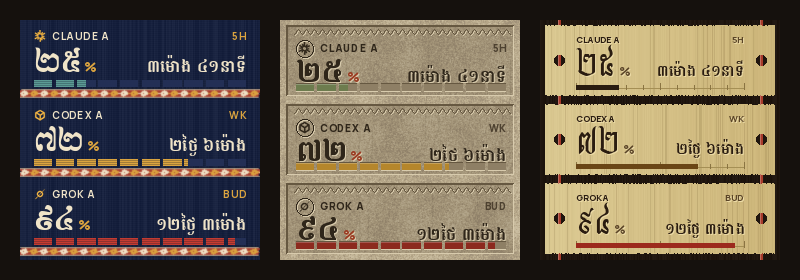

# minitv: TokenTV with Khmer faces

A copy of [TokenTV](https://github.com/click6067-ship-it/token-tv) (MIT, see [LICENSE](LICENSE) and [NOTICE](NOTICE)) with three added clock faces for a GeekMagic SmallTV, made from Cambodian craft rather than from pictures of it.

<p align="center"></p>

| Face | Made from | Details |
| --- | --- | --- |
| `hol` | a silk *sampot hol* | woven indigo ground, ikat bands in natural dyes with feathered edges, gauges as woven blocks |
| `bayon` | carved sandstone | grained stone wall, recessed panels with a lotus-petal frieze, engraved type, gauges as slots inlaid with pigment |
| `sastra` | a palm-leaf manuscript | leaf strips strung on a red cord, text incised and inked, the gauge a ruled line with a tick at every 10% |

On all three, the used percentage is in Khmer numerals (០១២៣៤៥៦៧៨៩) and the time to the reset is in Khmer words (ថ្ងៃ day, ម៉ោង hour, នាទី minute). Without Khmer text shaping on the machine (Pillow's raqm), the time falls back to `2d 6h`; the numerals do not need it. Everything else keeps its meaning from TokenTV: the window name (`5H`, `WK`, `BUD`), `OLD` for an old reading, a dash and `NO DATA` when nothing was reported, never `0`.

```bash
python3 -m venv .venv && .venv/bin/pip install -e .
.venv/bin/token-tv demo --out token-tv-demo      # writes demo-hol.jpg, demo-bayon.jpg, demo-sastra.jpg from sample data
.venv/bin/token-tv start --face hol              # on the machine that talks to the clock; or pick one in the dashboard
.venv/bin/python scripts/render_khmer_faces.py   # redraws docs/images/khmer-*.png
```

The code is in `token_tv/khmer.py`. Fonts: Moul, Bokor, Battambang and Noto Serif Khmer (SIL OFL 1.1, licences beside them in `token_tv/web/`).

---

<h1 align="center">TokenTV</h1>
<p align="center">
  <a href="https://github.com/click6067-ship-it/token-tv/releases/latest"></a>
  <a href="https://github.com/click6067-ship-it/token-tv/blob/main/LICENSE"></a>
  <a href="https://hackaday.com/2026/10/06/smalltv-hacking-with-surprisingly-little-fuss/"></a>
  <a href="https://github.com/steipete/CodexBar#desk-display"></a>
</p>

<p align="center"> <a href="https://youtube.com/shorts/FN5DLILYiI0"></a></p>
<p align="center"></p>

Turn a ~$5 AliExpress clock (GeekMagic SmallTV) into a physical AI usage dashboard. No firmware flashing.

**Live demo:** [token-tv.vercel.app](https://token-tv.vercel.app)  
**YouTube:** [https://www.youtube.com/shorts/FN5DLILYiI0](https://youtube.com/shorts/FN5DLILYiI0)  
**Try it:** [live demo](https://token-tv.vercel.app) or `npx token-tv demo`, no clock or login needed.  
**Set it up:** run `npx token-tv start` (or `uvx token-tv start`) on a computer that stays on. It finds your signed-in tools and the clock on your Wi-Fi, keeps running in the background and opens your dashboard. Or tell your AI *"Set up TokenTV for me"* ([AGENTS.md](https://github.com/click6067-ship-it/token-tv/blob/main/AGENTS.md)).

**New: Arcade.** When you're coding, the bots get busy too. Codex, for example, rains code to grow flowers while it spends tokens: the more it spends, the fuller the garden. Grok refuels its rocket and, resting, gazes up at Earth, and Copilot and Anti are the newest friends.

<p align="center">    </p>

**Each reacts in its own way.** with little left, one rushes and another frets. 
**And a few secret scenes.** Some come only at certain hours, some only after a bot has really worked, and some almost never. for a moment, and we're not telling you which. [The collection](https://token-tv.vercel.app/collection/) shows how much is out there.

Simple numbers at a glance, and cute while it's at it. Coding alone at 3 a.m.? Your bots are still up with you, and someone might even make you coffee. Ideas, suggestions and PRs are welcome. *Cuteness is a feature.*
