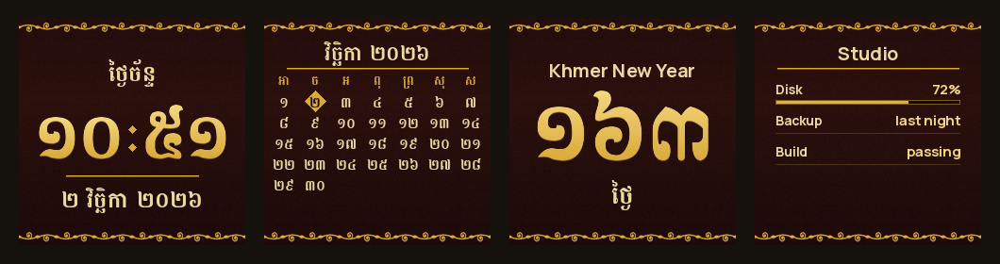

# Desk mode

`token-tv desk` uses the clock for things that are not token usage. It draws 240×240 pictures with the same
Khmer gold-on-lacquer look as the `kbach` face and sends them through the same upload code as `token-tv run`,
so the clock keeps its own firmware.

```bash
token-tv desk --init     # writes desk.json and board.json beside your TokenTV config (never overwrites)
token-tv desk --out pages
token-tv desk --device-url 192.168.0.50
```



## desk.json

```json
{
  "device_url": "http://192.168.0.50",
  "timezone": "Asia/Phnom_Penh",
  "seconds": 60,
  "night": {"from": "23:00", "to": "06:00"},
  "pages": [
    {"type": "clock"},
    {"type": "calendar"},
    {"type": "countdown", "label": "Khmer New Year", "date": "2027-04-14"},
    {"type": "board", "file": "board.json", "max_age_minutes": 120}
  ]
}
```

| Key | Meaning |
| --- | --- |
| `pages` | what to show, in order; each takes a turn of `seconds` |
| `seconds` | 30 to 3600 (default 60). Every change is written to the clock's memory, so do not set it lower than you need |
| `timezone` | an IANA name; default is this computer's time. Windows needs the `tzdata` package for names |
| `night` | between these times the clock shows one nearly dark picture, written once and left alone until morning |
| `device_url` | the clock; if missing, `--device-url`, then the `device_url` in TokenTV's `config.json` |

## Pages

- **clock**: `១០:៥១`, the weekday (`ថ្ងៃច័ន្ទ`), and the date as day, month and year in Khmer numerals and month names. The year is the common (Gregorian) year.
- **calendar**: this month, Sunday first, today in a gold lozenge.
- **countdown**: `label` and `date` (`YYYY-MM-DD`). Days left in Khmer numerals; on the day, `ថ្ងៃនេះ`; after it, a dash and `PAST`.
- **board**: the rows of a JSON file, up to five:

```json
{"title": "Studio", "items": [
  {"label": "Disk", "value": "72%", "percent": 72},
  {"label": "Backup", "value": "last night"}
]}
```

`label` and `value` can mix Latin and Khmer. `percent` (0 to 100) adds a gauge that turns from jade to gold, vermilion and crimson at 50, 80 and 90. Write the file from anything: a cron job, a build script, a home-automation hook. A file older than `max_age_minutes` is marked **OLD** and drawn faded; a missing or unreadable one shows a dash and **NO DATA**. Nothing is made up.

## How it behaves

- **One program per clock.** If `token-tv run` or autostart already drives the clock, desk mode says so and stops. Stop the other one first (`token-tv autostart off`).
- **Your clock's own settings are saved first** (the same backup `token-tv run` makes) and come back with `token-tv desk --restore`.
- **An identical picture is not written again.** With a clock page and `seconds` of 60, the picture changes every minute; at night it does not change at all.
- **Flash wear.** The clock stores each picture in cheap flash memory. A new page every 60 seconds is about 1 400 writes a day. If that worries you, use a larger `seconds`, fewer pages, or leave the clock page out; the night window already stops the writes for hours.
- **Without Khmer text shaping** (Pillow without raqm, which Windows and macOS builds may lack), weekday and month names fall back to Latin (`MON`, `NOV`); the numerals stay Khmer.

## Writing your own page

A page is a function from a moment to a 240×240 picture; see `render_clock` in `token_tv/desk.py`. Use `canvas()` for the lacquer and vines, `mixed()` for text that may hold Khmer and Latin, and `kbach.gilded()` for gold numerals. Add the type to `PAGE_TYPES`, `load_config` and `render_page`.
